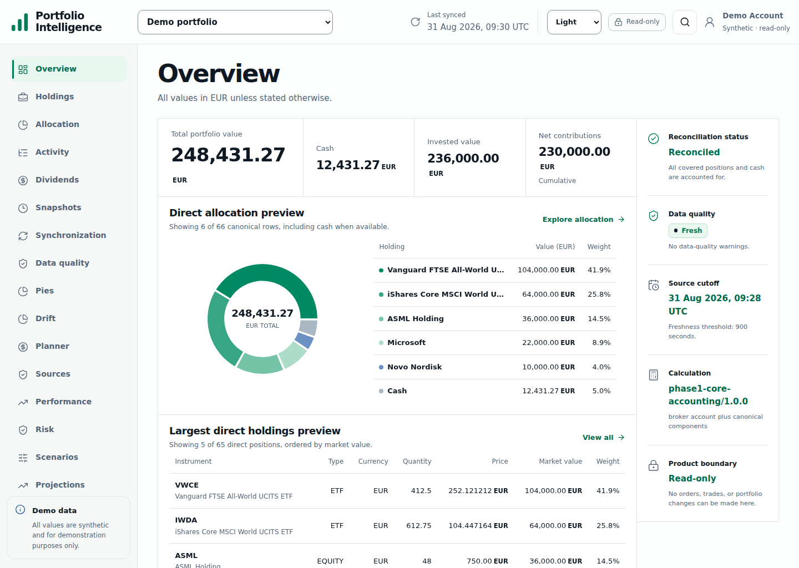
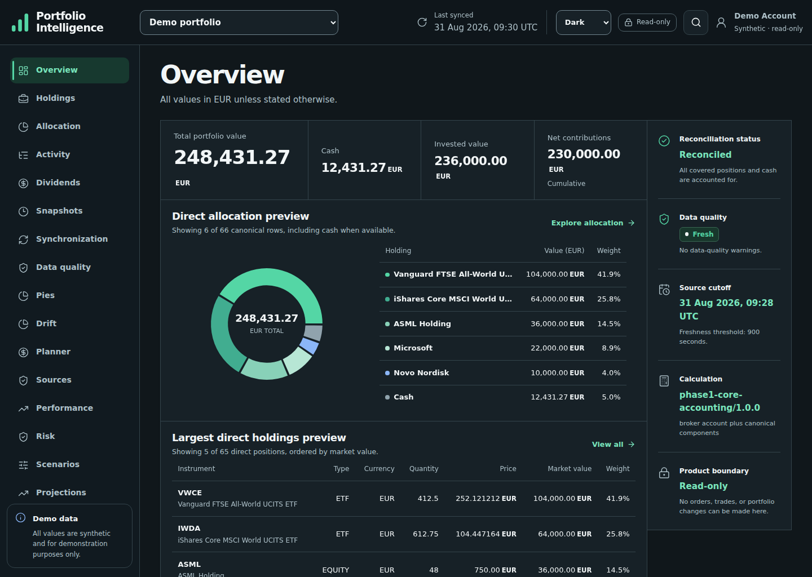
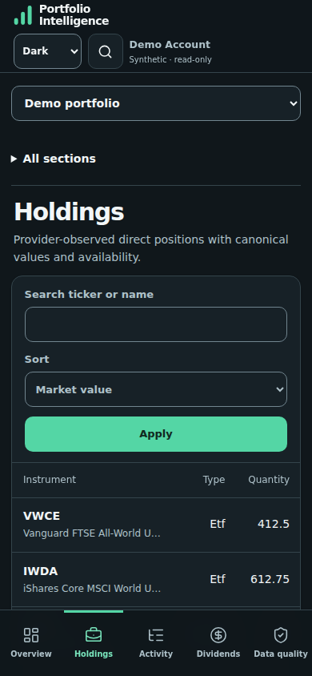

# Trading 212 Portfolio Intelligence

A read-only portfolio analytics system with exact decimal accounting, traceable
source data, asynchronous analysis and responsive web, API and MCP interfaces.

Portfolio analysis depends on reconciling positions, cash flows, prices and
reference data recorded at different times and in different currencies. This
project makes those dependencies explicit: results retain their valuation time,
source evidence, methodology, coverage and data-quality state. The implementation
connects brokerage ingestion and financial accounting to saved analyses, research
notes, manual planning and private reports.

**LOCAL/DEMO: COMPLETE — ACCEPTED — ARCHITECTURE FROZEN — PROJECT CLOSED.**
The [owner acceptance and closure](docs/implementation/LOCAL_DEMO_ACCEPTANCE_20261117.md)
were recorded on 17 November 2026. The
[accepted architecture baseline](docs/DESIGN_FREEZE_LOCAL_DEMO_20261117.md)
defines the completed synthetic demonstration and local implementation scope.
External-provider and production qualification remain separate.

## Interface

<table>
  <tr>
    <th width="50%">Desktop · Light</th>
    <th width="50%">Desktop · Dark</th>
  </tr>
  <tr>
    <td>
      <a href="docs/media/local-demo-overview-light-20261117.png">
        
      </a>
    </td>
    <td>
      <a href="docs/media/local-demo-overview-dark-20261117.png">
        
      </a>
    </td>
  </tr>
</table>

The same synthetic snapshot in both appearances. Open either image for full-size
detail.

<p align="center">
  <a href="docs/media/local-demo-holdings-mobile-20261117.png">
    
  </a>
  <br>
  <em>Holdings on a 390-pixel mobile viewport.</em>
</p>

These are genuine application captures using synthetic data. The
[capture manifest](docs/media/local-demo-captures-20261117.json) records their
dimensions, hashes and source provenance. Light, dark and system appearances share
the same semantic design tokens; the saved preference survives navigation, account
switches and sign-out.

## Implemented capabilities

| Area | Implementation |
| --- | --- |
| Portfolio accounting | Positions, cash, transactions, dividends, immutable snapshots, allocation and quantity/cash/value reconciliation. |
| Historical analysis | Cash-flow-aware performance, benchmark comparisons, income, attribution and retained source/FX observations. |
| Exposure and planning | Fund look-through with explicit unknown coverage, internal target portfolios, drift and manual contribution proposals. |
| Saved analytical work | Versioned risk, stress-scenario, projection and goal definitions, with saved inputs, job states, results and limitations. |
| Research and reporting | Retained source revisions, owner notes and review acknowledgments; explicit evidence selection for PDF, CSV, XLSX and JSON reports. |
| User interfaces | Account-scoped REST and MCP operations, responsive web/PWA pages, alert rules, saved workspace layouts and authorized artifact downloads. |

Internal plans, targets and reports never place trades or modify a broker account.
The [32-route coverage record](docs/implementation/LOCAL_DEMO_ROUTE_COVERAGE_20261117.md)
distinguishes implemented features from the browser paths exercised during the
accepted milestone.

## Architecture

```text
Web / PWA --> FastAPI --+
                       +--> Application services --> Domain / analytics
MCP tools/resources ---+             |
                                     v
PostgreSQL <--------------------------+
    ^
    |
    +--> Workers + dispatcher <--> Redis
                   |
                   v
       Trading 212 adapter (10 GET capabilities)
```

The applications share typed domain, application, analytics, persistence and
security packages. REST, web and MCP adapters expose bounded operations over those
services. PostgreSQL holds canonical financial data, retained evidence and durable
job state. Outbox dispatch separates accepted work from queue delivery; Redis
provides non-authoritative messaging, coordination and caching. Background workers
perform ingestion and bounded analytical/report jobs.

| Layer | Technology |
| --- | --- |
| Financial and application services | Python 3.13, FastAPI, Pydantic, Decimal |
| Persistence | PostgreSQL 18, SQLAlchemy, Alembic |
| Background processing | Celery, PostgreSQL job/outbox records, Redis 8 |
| Web and visualizations | Next.js 16, React 19, TypeScript, Recharts, CSS Modules and shared UI primitives |
| Interfaces and verification | REST, MCP, generated contracts, pytest, Hypothesis, Vitest and Playwright |

The [accepted architecture freeze](docs/DESIGN_FREEZE_LOCAL_DEMO_20261117.md)
describes the implemented topology; the [foundation architecture](docs/SYSTEM_ARCHITECTURE.md)
retains the original package boundaries and runtime contracts. Lockfiles and the
[technical baseline](docs/implementation/PHASE_3_TECHNICAL_BASELINE.md) define exact
tool and dependency versions.

## Financial correctness and privacy

Authoritative monetary accounting uses Decimal/NUMERIC representations, explicit
currencies and declared rounding rules. Cross-currency values require sourced FX;
deposits and withdrawals remain distinct from internal purchase/sale flows.
Timestamps use timezone-aware UTC. Missing, unavailable, stale, partial, estimated,
unreconciled, failed and actual zero values remain distinguishable. Results retain
method/version, source time, provenance, coverage and warnings; modeled results
also retain their assumptions and numerical profiles. Charts use numeric screen
coordinates while exact server values remain available in labels and tables.

The broker adapter admits exactly the
[ten allowlisted GET capabilities](config/contracts/trading212-read-allowlist.yaml)
and rejects other methods, paths and parameters before dispatch. Broker credentials
stay server-side. Account-scoped authorization and current source permissions
govern private reads and downloads; artifacts carry declared formats, sizes and
SHA-256 digests. Browser and MCP surfaces expose typed operations rather than
generic HTTP, SQL or filesystem access. See the
[financial policy](docs/analytics/FINANCIAL_CALCULATION_POLICY.md),
[reconciliation policy](docs/analytics/DATA_QUALITY_AND_RECONCILIATION.md) and
[security architecture](docs/security/SECURITY_ARCHITECTURE.md).

## Engineering evidence

Tests separate unit, property, contract, security, migration, integration and
browser concerns. Synthetic fixtures support financial invariants, negative
authorization cases and explicit failure/recovery behavior. Source identity,
commands, outcomes and artifact hashes qualify each retained observation.

The owner reports that independent review of the accepted `cd2ff67` implementation
reran **981 frontend unit cases**, **55 focused frontend regressions** and **2 Python fixture-clock
tests**, together with frontend typecheck, lint and documentation checks. The review
also verified the retained evidence archive and its 481 members. These separate
executions are not added into a new test total.

Earlier source-qualified LOCAL/DEMO evidence includes 150 representative route
views, light/dark/mobile captures, account-isolation checks and three genuine
research-report journeys with twelve four-format browser downloads and independent
artifact inspection. The broader browser and database-backed suites were not
independently rerun during the acceptance review. The
[implementation report](docs/implementation/LOCAL_DEMO_IMPLEMENTATION_20261117.md)
and [validation report](VALIDATION_REPORT.md) retain the exact scopes and outcomes.

## Local setup

### Browser-only Demo

With Node.js **24.20.0** and Corepack available, run from the repository root:

```bash
corepack prepare pnpm@10.34.5 --activate
corepack pnpm install --frozen-lockfile
PORTFOLIO_DEMO_MODE=1 T212PI_WEB_ENVIRONMENT=local \
  corepack pnpm --filter @trading212/web dev --hostname 127.0.0.1
```

Open `http://127.0.0.1:3000/sign-in` and choose **Enter demo portfolio**.
This preview needs no database, brokerage account or provider credentials. It
demonstrates the synthetic interface; operations requiring retained analytical or
research services show their connected-runtime requirements.

### Persistent LOCAL runtime

Use Python **3.13.15**, uv **0.12.7**, Node.js **24.20.0**, Corepack/pnpm
**10.34.5**, GNU Make and Docker Compose. From a fresh checkout with the default
local ports available:

```bash
export COMPOSE_PROJECT_NAME=t212pi_synthetic
export POSTGRES_PASSWORD=portfolio
make bootstrap
make run-local
```

The password shown is the public synthetic development value. The commands install
the locked workspace and start PostgreSQL, Redis, migration/seed jobs, API,
workers, dispatcher, MCP and web. The seed is deterministic and idempotent; the
worker uses the synthetic provider. Open `http://localhost:3000/sign-in` and choose
**Start local session**. Research-specific report examples additionally require
retained research fixtures and their current access grants.

Use [.env.example](.env.example) for configuration and the
[local operations guide](docs/operations/LOCAL_AND_DEPLOYMENT.md) for host development,
ports and service details. In the same shell, `make stop-local` stops that Compose
project while retaining its named data volume. No real account access is required
for either demonstration.

## Status and qualification boundaries

The owner has accepted and formally closed the LOCAL/DEMO project, preserving its
reviewed implementation and architecture baseline.
Broader Phase 3 qualification remains separate: Checkpoint B is incomplete, all
30 acceptance rows and 48 scenarios remain pending with zero accepted, and P3-10
is unstarted. CI remains disabled/unverified; real-provider activation, Live access
and production deployment remain outside the accepted scope.

Five deep route patterns retain source/shared-unit evidence without fresh
dedicated browser execution. The immutable public offline fallback intentionally
uses a fixed-dark palette. Historical admission-performance, whole-Web-tree
repeatability and nonzero scanner outcomes remain recorded, alongside independently
classified nonsecret findings and the known framework/dependency advisory. These
limitations and proposed future qualification contracts are documented in
[project status](PROJECT_STATUS.md) and the
[contract proposals](docs/verification/LOCAL_DEMO_CONTRACT_PROPOSALS_20261117.md);
the proposals have not changed the original gates or thresholds.

## Reading guide

| Question | Start here |
| --- | --- |
| What is the accepted baseline? | [LOCAL/DEMO architecture freeze](docs/DESIGN_FREEZE_LOCAL_DEMO_20261117.md) and [design index](docs/DESIGN_INDEX.md) |
| How is the system structured? | [System architecture](docs/SYSTEM_ARCHITECTURE.md) and [domain/data model](docs/architecture/DOMAIN_AND_DATA_MODEL.md) |
| How are financial results derived? | [Financial policy](docs/analytics/FINANCIAL_CALCULATION_POLICY.md), [performance accounting](docs/analytics/PERFORMANCE_ACCOUNTING.md) and [data quality](docs/analytics/DATA_QUALITY_AND_RECONCILIATION.md) |
| How are access and private data protected? | [Security architecture](docs/security/SECURITY_ARCHITECTURE.md) and [broker integration contract](docs/integrations/TRADING212_API_CONTRACT.md) |
| How do I reproduce local behavior? | [Local operations](docs/operations/LOCAL_AND_DEPLOYMENT.md), [Makefile](Makefile) and [test strategy](docs/engineering/TEST_STRATEGY.md) |
| What was implemented and checked? | [Implementation report](docs/implementation/LOCAL_DEMO_IMPLEMENTATION_20261117.md), [route coverage](docs/implementation/LOCAL_DEMO_ROUTE_COVERAGE_20261117.md) and [validation report](VALIDATION_REPORT.md) |

Repository maintenance follows the [documentation governance](docs/DOCUMENT_GOVERNANCE.md):
commit directly to `main`; no branches or pull requests. Changes preserve a linear
history and receive validation appropriate to their scope.

## Author and license

Created and maintained by **Michail Athanasios Peppas** as an independent software
engineering project.

The source is governed by the proprietary terms in [LICENSE.md](LICENSE.md).
Repository visibility and access grant no license to redistribute or deploy it. Third-party
dependency, reference-data and provider rights retain their own terms and require
review before distribution.
