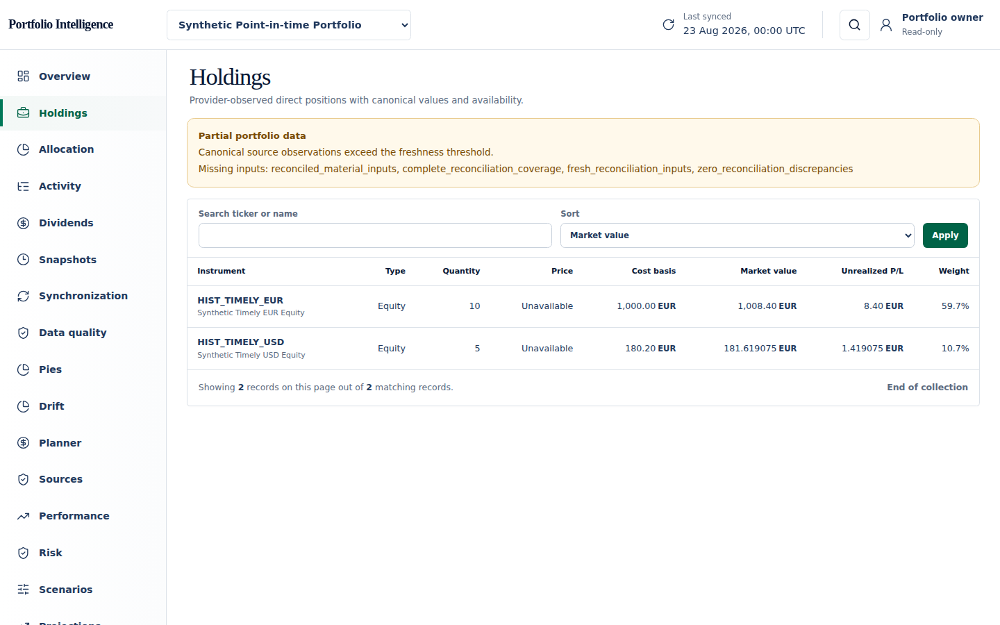

# Trading 212 Portfolio Intelligence

A strictly read-only portfolio analytics platform combining brokerage ingestion,
financial accounting, reconciliation, saved analysis and API, web and MCP views.
Monetary values use explicit currencies and Decimal representations; source,
valuation time, coverage and quality remain attached to results.

## Current status

Phase 3 Checkpoint B remains incomplete. The SAST parser and account-intent
corrections pass their focused checks, including genuine held-response Back on
three viewports. Complete Python executions still fail; native branch-aware
coverage passes at 88.05%, and 966 TypeScript tests pass. Admission and whole-tree
Web repeatability remain failed. Complete current browser and restart/restore
qualification retain explicit local prerequisites. Known dependency advisories,
original failures and post-commit security observations remain separate.

All **30 acceptance rows** and **48 scenarios** remain pending, **zero accepted**.
See the [current bounded report](docs/implementation/PHASE_3_BOUNDED_QUALIFICATION_20261117.md),
the [current 78-item traceability](docs/implementation/PHASE_3_BOUNDED_TRACEABILITY_20261117.md),
and [historical complete traceability](docs/implementation/PHASE_3_FINAL_LOCAL_TRACEABILITY_20261116.md).
No complete current-SHA validation pass, Phase 3 acceptance or production readiness
is claimed. P3-10, CI activation, real providers, production and distribution remain
separately gated. The three UI design documents remain drafts.

## Qualification history

Earlier controlled admission, stabilization and Batch 1/2 observations retain their source qualifications in the [16 November report](docs/implementation/PHASE_3_FINAL_LOCAL_QUALIFICATION_20261116.md), [controlled environment record](docs/implementation/PHASE_3_CONTROLLED_ENVIRONMENT_20261116.md), [Batch 1 report](docs/implementation/PHASE_3_BATCH1_20261114.md) and [Batch 2 report](docs/implementation/PHASE_3_BATCH2_20261114.md). Phase 1 has source-bound acceptance evidence; the owner accepted Phase 2 for progression. Those decisions do not accept Phase 3.

## Architecture and implemented scope

~~~text
Next.js web / PWA ---- HTTPS API ----+
                                    +-- application services -- Decimal analytics
MCP tools/resources ----------------+           |
Worker and retained jobs -----------------------+-- PostgreSQL / source evidence
                                                     |
                                              GET-only provider adapters
~~~

Source implements typed ingestion, quantity/cash/value reconciliation, snapshots,
cash-flow-aware performance, manual contribution planning, internal virtual
targets, reference-source coverage, look-through exposure, saved reports and
alerts. Risk, scenario, projection and research components have scoped evidence;
their presence does not establish complete Phase 3 acceptance. PostgreSQL is
authoritative; Redis supports coordination and caching.

The broker boundary permits exactly the
[allowlisted capabilities](config/contracts/trading212-read-allowlist.yaml).
There is no broker order, transfer, CFD or Trading 212 Pie mutation. Internal
targets and manual allocation proposals do not execute broker actions. Browser
and MCP clients receive authorized projections rather than broker credentials
or generic HTTP, SQL or filesystem access.

The stack uses FastAPI/Pydantic, SQLAlchemy/Alembic and Celery in Python,
Next.js/React/TypeScript on the web, PostgreSQL and Redis.

## Local development

The workspace contains [API](apps/api/), [worker](apps/worker/),
[MCP](apps/mcp/) and [web](apps/web/) applications. Shared packages cover
[domain contracts](packages/domain/), [analytics](packages/analytics/),
[persistence](packages/persistence/), [security](packages/security/) and the
[sealed broker adapter](packages/trading212/). The tracked synthetic fixtures
and contract specifications support inspection without a brokerage account.

Use Python 3.13.15, uv 0.12.7, Node.js 24.20.0, Corepack, pnpm 10.34.5 and GNU Make. Docker Compose
is required for database-backed and full-stack gates. Review the
[current technical baseline](docs/implementation/PHASE_3_TECHNICAL_BASELINE.md),
[security corrections](docs/security/DEPENDENCY_REMEDIATION_20261113.md) and
[operations guide](docs/operations/LOCAL_AND_DEPLOYMENT.md) before starting
services. Keep secrets server-side in ignored local configuration. Use synthetic
seed data before configuring any external read-only provider.

~~~bash
make bootstrap
make docs-check
make format-check
make lint
make typecheck
make test-unit
make build
~~~

These are project commands, not a claim they all pass at this checkpoint.
make run-dependencies starts local dependencies; make run-local performs the
documented migration/seed/start sequence. Review account-selection configuration
and the current checkpoint instead of copying a historical scratch override.
No provider connection is needed for synthetic unit tests.
Compose defines seven long-running services and two one-shot migration/seed
services. Focused database checks need only PostgreSQL and, where used, Redis.

### Configuration without a broker connection

Use [.env.example](.env.example) as the configuration reference. Copy it to an
ignored `.env` for Compose and set a local database password; host processes
require explicitly exported settings. Keep these synthetic defaults for an
initial local review:

```dotenv
T212PI_ENVIRONMENT=local
T212PI_WORKER_PROVIDER=synthetic
T212PI_TRADING212_ENVIRONMENT=demo
T212PI_TRADING212_LIVE_ENABLED=false
T212PI_RUN_TRADING212_DEMO_SMOKE=0
T212PI_TRADING212_CREDENTIAL_BUNDLE=
```

Local synthetic authentication is restricted to loopback. Review the
[credential and Demo procedure](docs/operations/CREDENTIALS_AND_DEMO_VALIDATION.md)
before any separately authorized provider validation. Private credential files,
the original operator's environment and external checkpoint diagnostics are
absent from a clean clone; their absence does not prevent reviewing source or
synthetic test cases. The September resume document records those historical
local paths, rather than portable prerequisites.

For a fresh synthetic application instance, the following uses a separate local
Compose project and a public demo database password. It needs no broker account:

```bash
export COMPOSE_PROJECT_NAME=t212pi_synthetic
export POSTGRES_PASSWORD=portfolio
make bootstrap
make run-local
```

Open `http://localhost:3000/sign-in`, select **Start local session**, then choose
an authorized synthetic account if prompted. The seed is idempotent. Use
`make stop-local` in the same shell to stop this project while retaining its
volume. When using a different local password for host tests, set matching
`DATABASE_URL` and `TEST_DATABASE_URL`; the example URLs in `.env.example` use
the synthetic password above. Current startup qualification is recorded in the
stabilization report.

## Synthetic interface example



Genuine point-in-time synthetic holdings with partial, stale and unavailable data
states. Desktop: 1440×900. [Mobile full-page capture](docs/media/synthetic-holdings-mobile.png):
360×1108 from a 360×800 viewport. Capture provenance is in the evidence index.

## Verification and interpretation

Tests separate unit, property, contract, security, migration, integration and
browser checks. An offline pass does not qualify a database, browser, deployment,
licensed data source or real opening-history coverage.
[VALIDATION_REPORT.md](VALIDATION_REPORT.md) retains exact-source historical
observations; [PROJECT_STATUS.md](PROJECT_STATUS.md) identifies outstanding gates.
Do not combine repeated or differently scoped receipts into a new acceptance.

For a first technical review, read the
[design index](docs/DESIGN_INDEX.md),
[financial policy](docs/analytics/FINANCIAL_CALCULATION_POLICY.md),
[reconciliation policy](docs/analytics/DATA_QUALITY_AND_RECONCILIATION.md),
[security architecture](docs/security/SECURITY_ARCHITECTURE.md) and
[Trading 212 contract](docs/integrations/TRADING212_API_CONTRACT.md).

## Provenance and release

This independent project is maintained by Michail Athanasios Peppas. Source,
dependency locks, synthetic fixtures and source-bound receipts provide evidence;
repository size and test inventories are not product acceptance. Retained
agent-assisted development/review records document assistance without replacing
technical validation.

The existing [proprietary license](LICENSE.md) remains in force. Review provider,
reference-data and third-party rights and use synthetic data for a public
demonstration. Accessibility, licensing and deployment are separate decisions.
The standing [delivery policy](AGENTS.md) is to commit directly to `main`, with
no branches or pull requests, using small, fast-forward commits. Historical
task-specific branch records describe earlier work. Git delivery, release
acceptance and production deployment are separate decisions.
